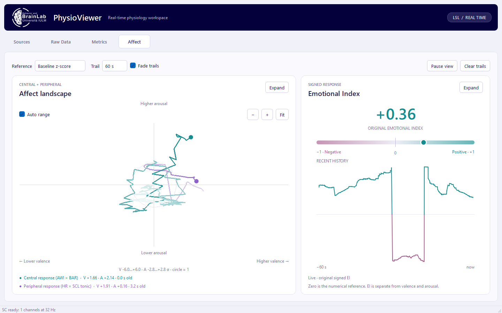

# Live application demonstrations

## Implemented Affect tab

[Watch the Affect video](./PhysioViewerRT-affect-demo.mp4) (MP4, 1:04, approximately 5 MB).

This newer recording shows the implemented Central/Peripheral circumplex and
separate signed Emotional Index. Both responses are driven by synthetic live
LSL streams. The original freshly recorded EYC/BSL files were reused; BSL samples
were reanalyzed through the same rolling cvxEDA pipeline as live SC, producing
compatible tonic SCL references. It demonstrates live trails, fading, manual
range, auto range, pause/resume, and expansion. This remains a local development
build; the recording is published independently of the application source changes.

## Initial calibration and waveform demonstration

[Watch or download the video](./PhysioViewerRT-live-demo.mp4) (MP4, 3:43, approximately 9 MB).

Recorded on 23 October 2026 using synthetic EEG, skin conductance (SC), and PPG streams sent through the real LSL acquisition and processing pipeline. This video shows the current local development build; some demonstrated UI changes are not yet committed to the repository.

Both calibration sessions were newly recorded through the application: EYC includes about 60 seconds of 32-channel EEG; BSL includes about 60 seconds of EEG, SC, and PPG.

| Time | Demonstration |
| --- | --- |
| 00:07 | Live raw signals |
| 00:15 | EYC calibration recording and inspection |
| 01:27 | BSL calibration recording and inspection |
| 02:38 | Baseline-normalized metrics |
| 02:53 | Signed Emotional Index history |
| 03:08 | EEG channel-count changes |
| 03:13 | Shared timebase change |
| 03:19 | SC expansion and autoscale |
| 03:25 | PPG expansion and autoscale |
| 03:31 | Combined live metrics |

This initial recording predates the Affect implementation; use the newer video above to see that tab. All data are synthetic, not participant recordings.
