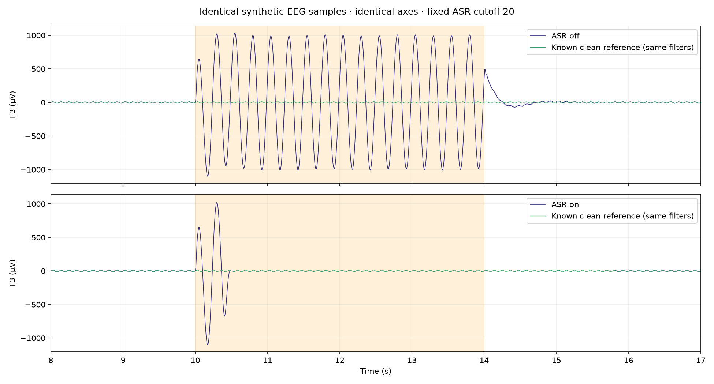

# Matched synthetic ASR comparison — 26 October 2026

Run from the repository root after installing requirements.txt:

```powershell
.venv\Scripts\python.exe tools/asr_comparison.py --output .test-tmp/asr-comparison
```

The tool saves a reproducible NPZ recording (including training and clean ground
truth), a JSON report and a PNG with identical axes. It uses the production
Processor and StreamingASR pipeline with fixed 16-sample chunks at 128 Hz.
Training is 60 seconds; evaluation is an independent 30-second, four-channel
signal. A 1000 µV 4 Hz artifact is added to F3 during seconds 10–14, before
filtering. Both ASR modes replay exactly the same contaminated samples.

For seed 2026 and cutoff 20, artifact-window F3 error relative to the filtered
clean reference fell from 702.86 to 217.05 µV RMS (69.12% reduction). The onset
transient is included: ASR takes time to respond, as the figure shows.
Other channels changed by approximately 0.31–0.54 µV RMS during that window.
On a separate artifact-free replay, normalized RMSE was approximately 6.5e-17
(numerical precision). All samples and four channels were preserved.

This is one controlled synthetic case, not a validation of clinical effectiveness,
real artifact removal, or every threshold/channel configuration. It does not
implement the proposed training-quality popup. Expand to blink, muscle, drift,
multiple seeds and real recordings before generalizing. The NPZ is generated
locally rather than committed; the script, report and plot are versioned.


